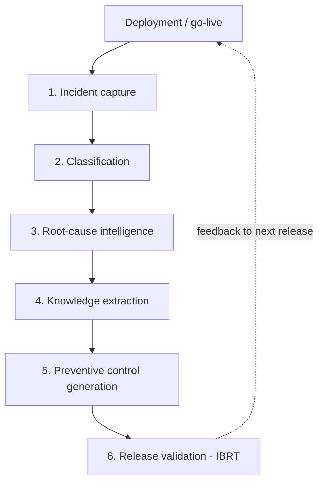

# HIFL for Databricks

**Hypercare Incident Feedback Loop (HIFL)**: turn post-go-live incidents into reusable data quality controls, on Databricks with PySpark.

This repository is the reference implementation of the framework described in:

> J. Ankam, "The Hypercare Incident Feedback Loop: A Case Study Framework for Turning Post-Go-Live Incidents into Data Quality Controls in SAP S/4HANA Programs."

Large ERP migrations keep running into data quality incidents during hypercare, the stabilization period after go-live. Most programs fix each incident and close the ticket. HIFL makes every incident leave something behind: a validation rule, a reconciliation, a regression test, or a runbook update. Those controls become a regression suite that every later release must pass. The paper calls this **Incident-Based Regression Testing (IBRT)**.



---

## What you get

| Phase | Module | What it does | Output table (prefix `hifl_`) |
|---|---|---|---|
| 1. Capture | `hifl.capture` | Reads any number of sources (ServiceNow, Jira, queues, logs), maps them to one schema, removes exact duplicates, flags the same issue raised in several channels | `incidents_raw`, `incidents` |
| 2. Classification | `hifl.classify` | Assigns each incident to one of six defect categories using reviewable keyword rules; a manual category always wins | `incidents` |
| 3. Root cause | `hifl.root_cause` | Splits the root-cause narrative into "five whys", infers the fishbone dimension, detects causes that recur across releases | `incidents`, `root_cause_summary` |
| 4. Knowledge extraction | `hifl.knowledge` | Creates knowledge assets per incident from the category-to-control map (paper, Table I) | `knowledge_assets` |
| 5. Controls | `hifl.controls` | Binds assets to executable checks, merges identical controls into one library, enforces the closure rule | `controls`, `closure_compliance` |
| 6. Release validation | `hifl.validation` | Runs the control library against a release and evaluates a pass/fail gate | `regression_results` (history) |
| Metrics | `hifl.metrics` | Release distribution, hypercare discovery rate, recurrence, MTTR, closure compliance, knowledge reuse | `metrics`, `release_distribution`, `category_distribution` |

**Defect taxonomy:** `MAPPING`, `MASTER_DATA`, `COMPLETENESS`, `BUSINESS_LOGIC`, `INTEGRATION`, `SOURCE_SYSTEM` (plus `UNCLASSIFIED`).

**Built-in check types** (`hifl.rules_engine`): `not_null`, `unique`, `accepted_values`, `referential_integrity`, `mapping_coverage`, `row_count_reconciliation`, `control_total`, `expression`, `sql_assertion`.

### Design choices that matter in production

* **Native Spark only.** No Python UDFs, RDDs or `sparkContext`, so the code runs on serverless, shared-access and single-user clusters (it is tested through Spark Connect).
* **ANSI-safe.** Parsing uses `try_*` functions, so bad dates or numbers become nulls instead of failing the job.
* **Configuration over code.** Sources, taxonomy keywords and control bindings are JSON files that your data quality lead can review in a pull request.
* **A failing control never stops the suite.** It is recorded as `ERROR` with its message, and the gate decides.
* **Works with Unity Catalog or `hive_metastore`.** All table names are fully qualified and quoted.

---

## Requirements

* Databricks Runtime **14.3 LTS or later** (Spark 3.5+), or serverless compute
* Unity Catalog (recommended) or `hive_metastore`
* Permission to create a schema and tables in the target catalog

No extra libraries are needed: HIFL uses only PySpark and the Python standard library.

---

## Quick start A: Databricks Git folder (about 5 minutes)

1. In Databricks, go to **Workspace -> Create -> Git folder** and paste this repository's URL.
2. Open `notebooks/00_setup`, set the `catalog` and `schema` widgets, attach compute and **Run all**. This creates the schema and loads the synthetic demo tables.
3. Open `notebooks/01_run_hifl_pipeline` with the same widgets and **Run all**.
4. Open `notebooks/03_hifl_dashboard` to explore the results.

With the shipped demo data you should see 64 distinct quality events (35 in R1 hypercare, 11 in R2C1 hypercare, 18 in R2C2/R5 UAT, so a hypercare discovery rate of 71.9%), 3 cross-channel duplicates, 7 controls in the library, and a release gate that **fails on purpose**. Two blocking controls catch problems planted in the demo data: an unmapped reason code and an orphan supplier location.

## Quick start B: Databricks Asset Bundle (CI/CD)

```bash
databricks bundle validate
databricks bundle deploy -t dev
databricks bundle run hifl_pipeline -t dev          # setup + full pipeline
databricks bundle run hifl_release_gate -t dev      # IBRT gate only, fails on blocking findings
```

Override variables with `--var`, for example `--var="catalog=analytics" --var="schema=hifl" --var="load_demo_data=false"`.
The jobs use serverless compute by default; see the comment at the top of `databricks.yml` to use a cluster instead.

## Quick start C: Python package / command line

```bash
pip install .                      # or build a wheel: pip wheel . --no-deps
hifl-run --config conf/hifl_config.json --catalog main --schema hifl --release-id R4 --fail-on-gate
```

From Python:

```python
from hifl.pipeline import run_from_config

run = run_from_config(spark, "/Workspace/Repos/me/hifl-databricks/conf/hifl_config.json",
                      overrides={"catalog": "main", "schema": "hifl"}, release_id="R4")
print(run.gate.summary())
display(run.metrics)
```

---

## Using your own data

Edit the three files in `conf/`. Paths are relative to the repository root, and `${schema_fqn}` is replaced with your `catalog.schema`.

### 1. Incident sources: `conf/hifl_config.json`

Each source is read, then mapped to the canonical columns with `column_map` (canonical name -> your column):

```json
{
  "name": "ServiceNow",
  "table": "main.itsm.incident",
  "column_map": {"source_record_id": "number", "title": "short_description",
                 "release_cycle": "u_release", "status": "state", "opened_at": "opened_at",
                 "resolved_at": "resolved_at", "business_object": "u_business_object",
                 "root_cause_text": "u_root_cause", "resolution_text": "close_notes",
                 "manual_category": "u_hifl_category"}
}
```

Supported readers: `"table"` (any table or view), `"path"` + `"format"` + `"options"` (files in a Unity Catalog Volume or cloud storage), and `"local_csv"` (small files kept in the repository). Optional keys: `"defaults"` (constant values for missing columns) and `"day_first": true` for `dd/MM/yyyy` dates.

Canonical columns: `source_record_id, title, description, release_cycle, phase, priority, status, opened_at, resolved_at, business_object, assignment_group, root_cause_text, resolution_text, manual_category`. All are optional except a title or description, which the classifier needs.

The discovery phase (`HYPERCARE`, `UAT`, ...) comes from `phase` if you have it, otherwise from the release label, using the regular expressions `hypercare_pattern` and `uat_pattern` in the config.

**Tip:** write root causes as a chain of whys separated by `->`, for example `Goods receipt blocked -> supplier location missing -> supplier location governance gap`. HIFL stores each step, uses the last one as the primary root cause, and detects when the same cause shows up in another release.

### 2. Taxonomy keywords: `conf/classification_rules.json`

A plain map from category to keyword list. Matching is case-insensitive and whole-word. When two categories score equally, the earlier category in the taxonomy order wins. Check `predicted_category`, `category_scores` and `classification_confidence` in `hifl_incidents` to tune the rules.

### 3. Control bindings: `conf/control_bindings.json`

A binding turns a knowledge asset into an executable check for a business object (`"*"` matches any object):

```json
{
  "control_template": "mapping_reconciliation",
  "business_object": "REASON_CODE",
  "check_type": "mapping_coverage",
  "severity": "HIGH",
  "description": "Every legacy reason code must have an S/4HANA mapping",
  "params": {"source_table": "${schema_fqn}.demo_legacy_orders", "source_column": "reason_code",
             "mapping_table": "${schema_fqn}.demo_reason_code_map", "mapping_column": "legacy_code"}
}
```

Assets without a binding are listed as `NEEDS_BINDING` in `hifl_knowledge_assets` and on the dashboard. That list is the data quality team's backlog.

| Control template (from Table I) | Typical check types |
|---|---|
| `mapping_reconciliation` | `mapping_coverage`, `referential_integrity` |
| `master_data_validation` | `referential_integrity`, `unique`, `not_null` |
| `record_count_reconciliation` | `row_count_reconciliation`, `control_total` |
| `rule_regression_test` | `expression`, `sql_assertion` |
| `interface_monitoring` | `control_total`, `row_count_reconciliation` |
| `source_profiling` | `not_null`, `accepted_values`, `expression` |
| `master_data_governance`, `cleansing_runbook`, `triage_runbook` | documentation assets, no check (`DOCUMENTED`) |

Every dataset parameter also accepts a SQL variant, for example `"table_sql": "SELECT * FROM main.s4.orders WHERE company_code = '1000'"`.

### The closure rule

`hifl_closure_compliance` marks every incident as `COMPLIANT`, `CLOSED_WITHOUT_ASSET` (rule violated), `OPEN_ASSET_READY` or `OPEN_PENDING_ASSET`. Closed statuses are configured with `closed_statuses`.

### The release gate

The gate fails when any control whose severity is in `gate_fail_severities` (default `CRITICAL`, `HIGH`) returns `FAIL` or `ERROR`. Use `notebooks/02_release_gate_ibrt` or the `hifl_release_gate` job as a pre-go-live step.

---

## Metrics

| Metric | Definition |
|---|---|
| `hypercare_discovery_rate` | Share of distinct events discovered during hypercare. Descriptive only; it is not a defect leakage rate. |
| `classification_coverage` | Share of events assigned to a taxonomy category |
| `recurrence_rate` | Share of events whose root cause appears in more than one release |
| `mean_time_to_resolution` | Average hours from `opened_at` to `resolved_at` |
| `closure_compliance` | Share of closed events linked to at least one preventive asset |
| `knowledge_reuse_ratio` | Bound assets per distinct control; above 1 means controls are shared across incidents |
| `regression_pass_rate` | Share of IBRT controls passing in the run |

---

## Repository layout

```
conf/            run configuration, taxonomy keywords, control bindings (JSON)
notebooks/       Databricks notebooks: 00 setup, 01 pipeline, 02 release gate, 03 dashboard
sample_data/     SYNTHETIC incidents and demo tables (regenerate: python scripts/generate_sample_data.py)
src/hifl/        the PySpark package
tests/           pytest suite: unit tests, end-to-end pipeline, notebook smoke tests
databricks.yml   Databricks Asset Bundle (two jobs)
```

## Development and tests

```bash
python -m venv .venv && source .venv/bin/activate
pip install -e ".[dev]"            # needs Java 17 for local Spark
pytest -q
HIFL_TEST_CONNECT=1 pytest -q      # same suite through Spark Connect (pip install "pyspark[connect]>=4.0")
```

The suite runs with ANSI mode on, as Databricks serverless does, and passes on PySpark 3.5.3 (Python 3.11), PySpark 4.0.1 (Python 3.13), and PySpark 4.0.1 through Spark Connect. GitHub Actions runs it on every push (`.github/workflows/ci.yml`).

## About the sample data

Everything in `sample_data/` is **synthetic**. It mirrors only the release-level shape reported in the paper (64 events: 35 / 11 / 18) so that the demo output can be compared with it. No record comes from a real program or organization.

## Citation

If you use HIFL in research, please cite the paper (see `CITATION.cff`).

## License

MIT, see `LICENSE`.
